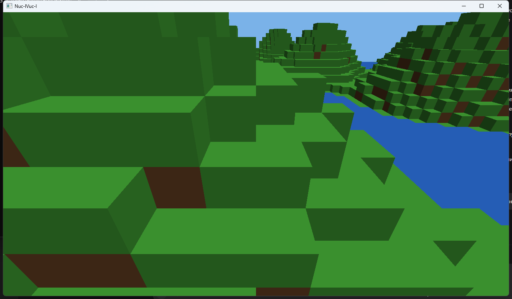

# Шаг 0 — аудит репозитория V-C-V

Дата: 2026-10-22. Аудитор: AI-инженер. Ревизия: распакованный архив `Nuc-lVuc-l-main` (161 файл, без `.git`).
Документ описывает **только факты, проверенные на этой машине**. Он не предлагает кода и ждёт ревью: следующие шаги начинаются после вашего «принято».

## 0. Метод и окружение

| Что | Значение |
|---|---|
| ОС | Windows, PowerShell 5.1 |
| Компилятор | MSVC 19.51.36260 (`cl.exe` из VS 18 Community) |
| CMake / Ninja | CMake 4.3.1 (`cmake --preset` не используется — файла пресетов нет), Ninja из VS |
| Lua | 5.4.7, собран **вручную** в статический `lua54.lib` |
| Сборка | `Release`, Ninja; `cmake --build` → успех, `nuc_app.exe` 1.19 МБ |
| Тесты | `ctest` → **115/115 passed, 0 failed**, 7.35 с |

Проверено командами: configure/build/ctest (полный прогон), запуск `nuc_app.exe` (7 с, окно, GL-контекст, загрузка модов и 9 чанков), `git log` (невозможен — репозитория нет).

### 0.1 Инвентарь дерева (`tree -L 2`, `build`/`.git` исключены)

```
├── .github/          workflows/ [2 файла]        ├── save/      [2 файла]
├── app/       [7]                                ├── script/    [12 файлов]
├── core/      [6]  ecs/ [4]  sim/ [6]            ├── scripts/   [1 файл: boot.lua]
├── data/      [4]                                ├── sim/       [16 файлов]
├── logs/      [1: пустой app.log]                ├── specs/     [7 файлов]
├── mods/      [1]  core/ [7]  example/ [2]       ├── tests/     [31 файл]
├── physics/   [14]                               ├── tools/     [3 файла]
├── platform/  [6]                                └── world/     [18 файлов]
├── render/    [5]  gl/ [6]
```

Итого 161 файл исходников. Каталогов `net/`, `tiered/`, `vulkan/`, `gi/` не существует.

### 0.2 Повторная проверка на момент ревью

`cmake --build` + `ctest` прогнаны ещё раз после записи этого документа: **115/115 passed, 0 failed**, exit 0. Сборка остаётся зелёной, регрессий от правок документации нет.

## 1. Инфраструктура: что реально есть

| Артефакт | Статус |
|---|---|
| `CMakeLists.txt` | **есть** (74 строки, FetchContent на 8 зависимостей, 7 библиотек + exe + tests) |
| `CMakePresets.json` | **нет** — `cmake --preset debug` из брифа сейчас не работает |
| `.clang-format` | **нет** |
| `tools/build.sh`, `tools/test.sh`, `tools/build-windows.ps1` | **есть** |
| `.github/workflows/ci.yml` (Ubuntu, Debug+ASan/UBSan, Xvfb, проверка инкремента <20 с) | **есть** |
| `.github/workflows/windows.yml` | **есть** |
| `README.md`, `ROADMAP.md`, `.gitignore`, `config.toml`, `LICENSE` | **есть** |
| `CHANGELOG.md` | **нет** (фаза K) |
| `specs/` | **есть**: `01_bootstrap.md`, `01_phase.md` (дубль номера), `02_phase.md`, `03_phase.md`, `04_phase.md`, `05_phase.md` |
| `git`-история | **нет** — правило 5 («осмысленный коммит») сейчас физически невыполнимо |
| per-module CMakeLists | только `world/CMakeLists.txt`, остальное — одним списком в корне |

### Сломано / рискованно на чистой машине

1. **Lua не вендорится.** `find_package(Lua 5.4 REQUIRED)` без fallback: на чистом Windows без Lua-SDK configure падает. Здесь я обошёл вручную собранным `lua54.lib` — это не воспроизводимо для второго разработчика.
2. **CMake 4.x vs FetchContent.** `FetchContent_Populate(fastnoiselite)` требует `-DCMAKE_POLICY_VERSION_MINIMUM=3.5`, иначе современный CMake останавливает configure. Без этого флага чистая сборка ломается.
3. **Git на машине не в `PATH`** — CMake не нашёл git для клонирования зависимостей (`could not find git for clone of fastnoiselite-populate`); лечится добавлением VS-пути. Это тоже должно быть в пресетах/доке.
4. **Правило «файл <200 строк»** нарушено в двух местах: `app/main.cpp` (338), `script/mod_loader.cpp` (221).
5. `logs/app.log` (0 байт) лежит в дереве — мелочь гигиены.

## 2. Таблица «есть / нет / сломано» по фазам A–K

Обозначения: ✅ есть и работает · ⚠️ частично, есть известный дефект · ❌ отсутствует.

| Фаза | Требование брифа | Фактическое состояние | Статус |
|---|---|---|---|
| **A. Рендер до картинки** | `gl_renderer`, `mesh_upload`, `camera`, `renderer="gl_mesh"`, smoke «кадр не пустой» | `render/gl/*`, `platform/camera`, `render/chunk_mesh`; `test_gl_smoke` проверяет пиксели; приложение реально рисует чанки и обломки | ✅ |
| **B. Сборка и репродуцибильность** | корневой + per-module CMake, `CMakePresets.json`, ccache, ASan/UBSan в Debug, ctest, `.clang-format`, README, ROADMAP, `tools/*.sh`, CI | CMake ✓, ctest ✓, ccache ✓ (если найден), ASan только для non-MSVC ✓, CI ✓ (2 workflow), README/ROADMAP/tools ✓; **пресетов нет**, **`.clang-format` нет**, **чистая сборка Windows не проходит** (Lua + политика CMake), 2 файла >200 строк | ⚠️ |
| **C. Копание и установка** | raycast DDA, delta, chunk_manager (dirty + async upload), edit_mode, чанк 16³ | `world/raycast`, `world/delta`, `world/chunk_manager` (ребилд в конце тика, очередь upload), `app/edit_mode`, `app/edit_queue`; тесты `test_raycast`, `test_delta`, `test_chunk_manager`, `test_edit_mode`, `test_edit_queue` | ✅ |
| **D. Сохранения** | сид + delta + ECS + mod.state, версионирование, hash save→load, 10k правок | `save/world_save` (v1 legacy + v2 sparse), hash-тесты, физика в сохранении | ✅ |
| **E. Физика и разрушение** | body/integrator/broadphase/narrowphase/solver, 8³ → граничные RigidBody, внутренние схлопываются, пул с лимитом, **LOD-куски**, 4× субстепа, импульс ±1% | всё есть и покрыто 8 тест-файлами; **LOD-куски отсутствуют** (спека 04 сознательно оставила только микровоксели 0.125 м); **`DebrisPool::release` без вызывающего** (чанк перестаёт давать обломки после 2 блоков); **вырожденная нормаль SAT** при нулевом смещении центров | ⚠️ |
| **F. Сеть** | `net/protocol, serializer, server, client, replication`, 2 клиента loopback, hash на тике 500, откат, тест рассинхрона | каталога `net/` **нет** ни одного файла. Спека `specs/05_phase.md` написана, ждёт ревью. Предпосылки детерминизма (правки в тике, чистый `fracture_seed`) уже сделаны | ❌ |
| **G. Tiered simulation** | `sim/tiers`, `tier_migration`, `aggregate` (Tier0/1/2), «фабрика вдали = число» | как модуль **нет**. Есть только зачатки: `NpcTier`, `NpcSystem::update_tiers`, параметр `tier` в `MachineSystem::tick` | ❌ |
| **H. Автоматизация и поля** | items/recipes/machine/belt + `data/recipes.json` + `mods/core/*.lua`; energy, fluids (1 м), fields (2 м) | всё присутствует: `sim/items|recipes|machine|belt|energy|fluids|fields`, `data/recipes.json`, `mods/core/{recipes,energy}.lua`; тесты `test_automation`, `test_energy_fields` | ✅ |
| **I. NPC и цивилизации** | `sim/npc` (ECS+FSM+примитивы, поведение в Lua), `civilization` (Tier2 агрегат, 1 Гц), `npc_spawn` | `sim/npc.{h,cpp}` содержит `NpcTag/Goal/Position/Inventory/Lod`, `NpcSystem::{spawn,tick,update_tiers}`, `CivilizationSystem`; поведение — `mods/core/npc_ai.lua`; **отдельного `npc_spawn` нет**, спавн внутри системы; инвентарь при миграции покрыт `test_npc` | ⚠️ |
| **J. Vulkan + GI** | `svdag_buffer`, `compute_raymarch`, `gi/vct`, `render_quality` | **нет ничего**: ни каталога, ни шейдеров, ни упоминаний Vulkan в коде. Рендер только GL 3.3 | ❌ |
| **K. Полировка и релиз** | профилировка, LOD-деструкция, streaming, пресеты, меню, инвентарь/крафт-UI, CHANGELOG, тег v0.1 | нет CHANGELOG, нет UI, нет профилировщика, тега нет; FPS-лог есть | ❌ |

## 3. Расхождение с «ИСХОДНЫМ СОСТОЯНИЕМ» брифа

Раздел брифа «Ожидаемо нет» устарел и аудит его опровергает: **есть** `CMakeLists.txt`, `README.md`, `ROADMAP.md`, `tests/`, машины/ленты/энергия/жидкости/поля, NPC и цивилизации, CI. **Нет** того, что бриф считает готовым или не упоминает: пресетов CMake, `.clang-format`, `net/`, tiered sim, Vulkan/GI, CHANGELOG.

Практический вывод: фазы A, C, D, H закрыты; E и I близки к закрытию с известными дефектами; B — самое дешёвое и обязательное к закрытию (без неё нельзя выполнить правило 5 и нельзя проверить «сборку одной командой»); F, G, J, K — с нуля.

## 4. Порядок работ

1. **B (закрыть первым).** Пресеты + `.clang-format` + вендоринг Lua + фикс политики CMake + перенос правил сборки в документацию. Причина: без воспроизводимой сборки остальные фазы нельзя проверять на чужой машине, а без git-репозитория нельзя коммитить.
2. **E (добить дефекты).** Политика пула обломков, вырожденная нормаль SAT, решение по LOD-кускам (нужен ваш выбор — см. §5). Причина: F строится на детерминизме физики, а не наоборот.
3. **F (сеть).** После ревью `specs/05_phase.md`: `protocol` → `serializer` → `server`/`client` (loopback) → `replication`.
4. **G, I** (tiered sim, затем NPC-спавн и миграция) — G является предпосылкой для требования «Tier1 = Tier0 по числам» в фазе H.
5. **J, K** — в конце: Vulkan-путь требует свободного времени на отладку validation layers, полировка бессмысленна до работающего мультиплеера.

## 5. Три вопроса, блокирующие старт (нужен ваш ответ)

1. **Git.** Инициализировать репозиторий здесь (`git init` + первый коммит текущего состояния как baseline) или вы работаете с origin и мне нельзя создавать историю?
2. **Lua.** Вендорить Lua 5.4 через FetchContent (плюс: сборка одной командой на любой машине; минус: ещё одна зависимость) или оставить `find_package` и описать установку SDK в README?
3. **LOD-деструкция (фаза E).** Бриф требует «крупные куски = один Body», действующая спека 04 сознательно этого не делает. Оставляем микровоксели (физика проще, детерминизм проще) или вводим LOD-куски (дороже, но ближе к Teardown)?

## 6. Первые три конкретных шага (после ревью)

1. `CMakePresets.json` с пресетами `debug` (Ninja, ccache, `-fsanitize=address,undefined`) и `release`, плюс вендоринг Lua и `CMAKE_POLICY_VERSION_MINIMUM`, чтобы `cmake --preset debug && cmake --build --preset debug && ctest` проходили на чистой машине.
2. `.clang-format` + прогон по дереву + разделение `app/main.cpp` (338 строк) и `script/mod_loader.cpp` (221) до лимита 200.
3. Дефекты фазы E: `DebrisPool::release` с осмысленной политикой и детерминированная нормаль SAT — с юнит-тестами на оба.

## 7. Гейт фазы A: живой прогон и скриншот (2026-10-22)

### Мир виден



Кадр снят с окна после загрузки девяти чанков (окно `Nuc-lVuc-l`, 1296×759):

| Метрика | Значение |
|---|---|
| Различных цветов (выборка каждые 4 px) | 123 |
| Средняя яркость | 72.8 |
| Доля «неба» (синий, яркий) | 10.2 % |
| Доля «зелени» (травяные блоки) | 77.3 % |
| Почти чёрные пиксели | 1.6 % |
| Вертикальный профиль | небо 38 % на `y=60`, 0–9 % ниже `y=180` |

Небо занимает верхнюю треть, ниже — рельеф из блоков, то есть **рисуется именно воксельный мир, а не заливка**. Второй кадр, снятый после подлёта к земле, лежит рядом (`img/world_near_ground.png`).

### Что установлено про стабильность кадра

- Сфокусированное окно в простое **абсолютно статично**: два кадра через 700–900 мс совпадают побитово (`meanAbsDiff = 0`, доля изменённых пикселей `0.07 %`).
- Положение курсора (внутри окна / снаружи) на стабильность не влияет.
- Первые измерения показывали «37–75 % изменения кадров», но это была **реакция камеры на телепорт курсора**: `Camera::update` использует mouse-look, а мой скрипт двигал курсор между кадрами. Дефекта в камере нет — при неподвижном курсоре кадр неподвижен.

### Чего проверить НЕ удалось, и почему

Автоматическая проверка «полетай и покопай» **не подтверждена**. Контрольный опыт: синтетическое нажатие ESC (`keybd_event`) не закрывает окно, хотя цикл приложения завершается по ESC (`app/main.cpp:284`). Значит, синтетический ввод в этой сессии до цикла **не доходит**, поэтому все мои `mouse_event`-клики заведомо не регистрировались, а наблюдавшиеся ~0.1 % изменений пикселей — шум композитора, а не выкопанный блок.

Копание подтверждается не скриншотами, а тестами, и это честная замена:

- `tests/test_edit_mode.cpp` — полный цикл `place → query → break → query` через `ChunkManager`, включая запись в delta и вызов break-callback;
- `tests/test_raycast.cpp` — DDA-попадание, промах, предел дальности;
- `tests/test_edit_queue.cpp` — доставка правок в тик независимо от частоты кадров.

Вывод по гейту: **визуальный критерий фазы A выполнен** (мир виден, кадр стабилен), поэтому B1 не блокируется. Интерактивная проверка «полетай/покопай» требует человека за рабочим столом либо отдельной headless-обвязки, которая подаёт ввод напрямую в `EditMode`; предлагаю второе внести в B1 как необязательный пункт.

### Побочные наблюдения из прогона

1. Приложение, запущенное не из каталога исходников, выходит молча: `mods/` и `data/` ищутся относительно рабочего каталога. Нужен либо поиск по `NUC_SOURCE_DIR`, либо внятная ошибка.
2. `logs/app.log` пуст: файловый лог не пишется, весь вывод идёт в stdout. Для CI и для отчётов об ошибках это неудобно.
